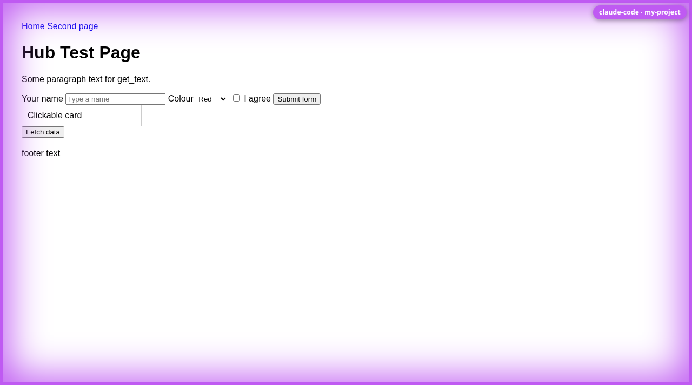
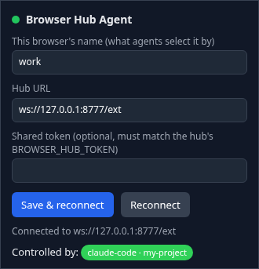

# Browser Hub

**Account-free, agent-agnostic control of Chrome, one profile at a time, with a visible border on whatever an agent is driving.**

Browser Hub is a small Chrome extension plus a local daemon. The extension runs in as many Chrome
profiles as you like and connects *outward* to the daemon; agents (Claude Code through MCP, Codex,
shell scripts, anything that can speak JSON) ask the daemon for a browser *by name* and drive it. No
Google, Anthropic or OpenAI sign-in is involved anywhere.

While an agent holds a browser, every window of that profile shows a coloured frame and a label naming
the agent session, so you always know which Chrome is being driven and by whom:



Each profile is named once in the extension's popup:



## Why this exists

The official Claude in Chrome extension is excellent but it is tied to one signed-in Claude account and
one Chrome profile at a time. With several Claude accounts, a dozen Chrome profiles and multiple Claude
Code sessions running at once, that means constant signing out and in, and no way to tell at a glance
which window an agent is about to click in. Browser Hub replaces the login with a name, lets any number of
agents target any number of profiles, and paints the target.

## How it works

```
 Claude Code (project A) ──MCP──> browser-hub-mcp ─┐
 Claude Code (project B) ──MCP──> browser-hub-mcp ─┤  ws://127.0.0.1:8777/agent
 browserctl / curl ────────────────────────────────┤
                                                   v
                                             browser-hub  (systemd --user, loopback only)
                                                   ^
                      ws://127.0.0.1:8777/ext      │
          ┌────────────────────────────────────────┼─────────────────────┐
   Chrome profile "work"                 Chrome profile "personal"   Chromium "scratch"
   [Browser Hub Agent ext]               [Browser Hub Agent ext]     [Browser Hub Agent ext]
```

| Piece | Where | Job |
|---|---|---|
| **Extension** (`extension/`) | loaded unpacked in each Chrome/Chromium/Brave profile | keeps a WebSocket to the hub, executes page commands, draws the border |
| **Hub** (`hub/src/`, `browser-hub`) | one systemd user service per machine | registry of connected browsers and agent sessions; routes requests; tells extensions who controls them |
| **MCP server** (`browser-hub-mcp`) | spawned by Claude Code or any MCP client | 23 tools, one hub session per client process |
| **CLI** (`browserctl`) | your shell | same methods from scripts and by hand |
| **HTTP** | `GET /browsers`, `POST /call` | for anything else; see `docs/protocol.md` |

A session selects a browser (`browser_select work`); from then on every call goes there, and the hub
remembers the last tab the session touched so `tabId` is optional. Two sessions can share a browser; the
label shows both names. When the session ends, the border goes away.

## What agents get

`browsers_list` · `browser_select` · `browser_identify` (flash the border) · `tabs_list` · `tab_new` ·
`tab_close` · `tab_activate` · `navigate` · `screenshot` · `read_page` · `find` · `get_text` · `click` ·
`fill` · `type` · `press_key` · `scroll` · `hover` · `evaluate` · `wait_for` · `console_read` ·
`network_read` · `window_resize`

`read_page` returns a compact outline of the page with stable refs:

```
- navigation
  - link [e1] "Home" href="/"
  - link [e2] "Docs" href="/docs"
- heading[1] "Welcome"
- textbox [e3] "Email" placeholder="you@example.com"
- combobox [e4] "Country" value="Norway" options=195
- checkbox [e5] "Remember me" unchecked
- button [e6] "Sign in"
```

and the other tools take those refs (`click e6`, `fill e3 ada@example.com`) or screenshot coordinates.

## Install

Requirements: Linux with systemd user sessions, Node 20+ on the system `PATH` (the service cannot see
nvm), npm, optionally rsync.

```sh
git clone https://github.com/0-x-a-a-5-5/browser-hub ~/src/browser-hub
~/src/browser-hub/ops/install.sh
```

The installer deploys a copy to `~/.local/share/browser-hub` (override with `BROWSER_HUB_HOME`), runs
`npm install` there, symlinks `browser-hub`, `browser-hub-mcp` and `browserctl` into `~/.local/bin`,
installs and starts `browser-hub.service` on port 8777, and registers the MCP server with Claude Code at
user scope if `claude` is on `PATH`. It is idempotent: run it again after pulling changes.
`ops/uninstall.sh` reverses everything.

Then, **once per Chrome profile** you want to control (Chrome offers no API or flag for this step):

1. `chrome://extensions` → enable *Developer mode* → *Load unpacked* → `~/.local/share/browser-hub/extension`
2. Click the extension's icon and give the profile a name (`work`, `personal`, …). The dot turns green once
   it is connected to the hub.

Check with `browserctl browsers`. Browser names live inside each Chrome profile, so updates and reinstalls
keep them.

### Another machine

Copy or clone the repo there and run the same `ops/install.sh`; everything the machine runs from lives
under `~/.local/share/browser-hub`, so extension and MCP paths are identical everywhere.

## Using it

### From Claude Code

Name the hub and the profile in the prompt, e.g. *"Using browser-hub, open the Jira board in the `work`
browser."* Claude calls `browser_select work`, the `work` profile's windows get the border with the
session's label, and the rest follows (`tab_new`, `read_page`, `click e12`, …).

- Each Claude Code session is its own hub session with its own colour. The label defaults to the project
  folder name; set `BROWSER_HUB_LABEL` to change it.
- Pin a project to a browser so you never have to name it, in that project's `.mcp.json`:

  ```json
  { "mcpServers": { "browser-hub": {
      "command": "browser-hub-mcp",
      "env": { "BROWSER_HUB_BROWSER": "work", "BROWSER_HUB_LABEL": "jira-bot" } } } }
  ```
- With exactly one browser connected, selection is automatic.
- If the official Claude in Chrome tools are also present, say "browser hub" so the right tools are used.

### From the shell

```sh
browserctl browsers                          # who is connected
browserctl -b work go https://example.com
browserctl -b work page                      # outline with refs
browserctl -b work click e3
browserctl -b work fill e5 "hello"
browserctl -b work shot --out shot.png
browserctl -b work eval 'document.title'
browserctl -b work page.snapshot filter=all  # any raw method with key=value params
```

### Over HTTP

```sh
curl -s localhost:8777/browsers
curl -s localhost:8777/call -H 'content-type: application/json' \
  -d '{"browser":"work","method":"page.navigate","params":{"url":"https://example.com"}}'
```

The full wire protocol (extension side and agent side) is in [`docs/protocol.md`](docs/protocol.md).

## Behaviour worth knowing

- **Extension → hub, never the other way.** Chrome cannot listen on a port, so the extension keeps a
  WebSocket to the hub and pings every 20 s, which also keeps the MV3 service worker alive. It reconnects
  with backoff (plus an alarm as backstop) when the hub restarts.
- **Refs** (`e1`, `e2`, …) stay stable for the life of a page. A ref whose element left the DOM fails with
  `STALE_REF`; call `read_page` or `find` again.
- **Two kinds of input.** `click ref` and `fill` act on the DOM directly: no banner, works under overlays,
  fires the `input`/`change` events frameworks listen for. Coordinate clicks, `click … trusted=true`,
  `type`, `press_key`, `hover`, wheel `scroll` and `evaluate` send real events through `chrome.debugger`,
  which Chrome announces with its yellow "is debugging this browser" bar. The debugger detaches (bar goes
  away) when no agent controls the browser any more.
- **Screenshots** are rescaled to CSS pixels, so coordinates read off the image are the coordinates you
  click. The border and label are hidden during capture unless `includeOverlay` is set.
- **Console and network** are recorded passively per tab (a MAIN-world console shim and `webRequest`), so
  history is available without having attached first.
- **Restricted pages** (`chrome://`, the Web Store, PDFs, `about:blank`) cannot run content scripts;
  page tools return `NO_PAGE_ACCESS` there. `navigate`, `tabs_*` and screenshots still work.

## Security model

The hub binds `127.0.0.1` only. Extension sockets must carry a `chrome-extension://` origin, and agent
sockets and HTTP requests must carry *no* `Origin` header at all, so a web page can never reach the hub.
Any local process can, which is the same trust level as the official extension's native-messaging host. To
require a shared secret, set `BROWSER_HUB_TOKEN` for the service (`systemctl --user edit browser-hub`), the
same value in each extension popup, and export it for agents.

The extension asks for `<all_urls>`, `tabs`, `scripting`, `debugger`, `webRequest`, `webNavigation`,
`storage` and `alarms`. That is what driving arbitrary pages requires; load it only in profiles you want
agents to be able to drive.

## Development

```sh
cd hub && npm test                  # hub unit tests against a fake extension
node test/e2e-overlay.mjs [name]    # against a real browser with the extension loaded
```

Headless end-to-end (Chromium keeps `--load-extension`; branded Chrome 137+ dropped it):

```sh
chromium --headless=new --user-data-dir=/tmp/bh-profile --load-extension=$PWD/extension \
  --no-first-run --disable-gpu --window-size=1280,800 https://example.com &
browserctl browsers
```

While developing, load the extension from the repo's `extension/` folder. After editing service-worker
files, reload the extension on `chrome://extensions` (Chrome caches the worker script); pages that were
already open get the content scripts re-injected on next use.

## Limitations

- Chromium-based browsers only (MV3, `chrome.debugger`). No Firefox.
- Cross-origin iframes are not walked by `read_page`; same-origin content and open shadow roots are.
- No file-upload tool yet (`<input type=file>` cannot be set from a script; it needs the debugger's
  `DOM.setFileInputFiles`, which is a natural next addition).
- Loading the extension into each profile is manual by design of Chrome; everything else is one script.
